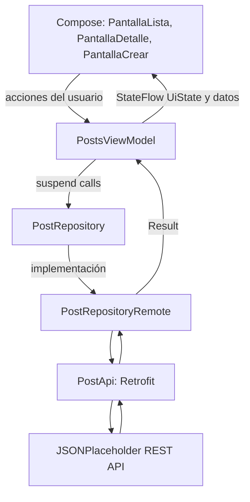
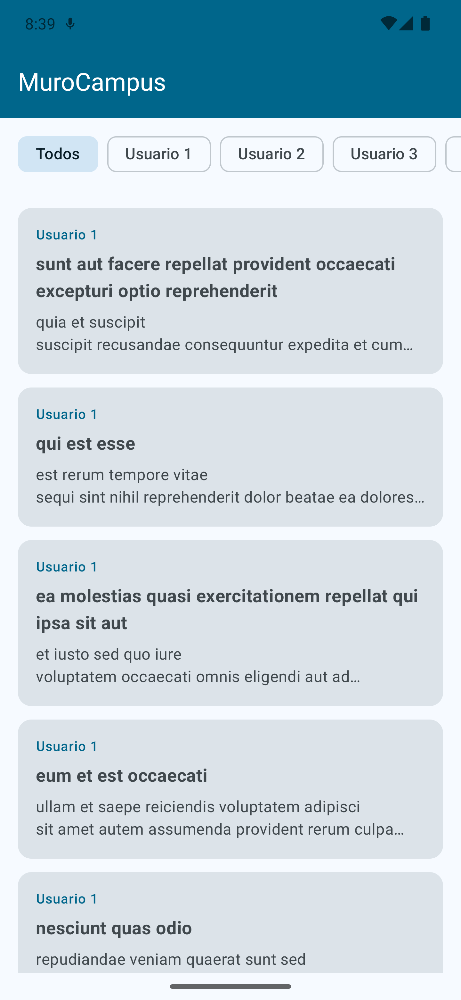
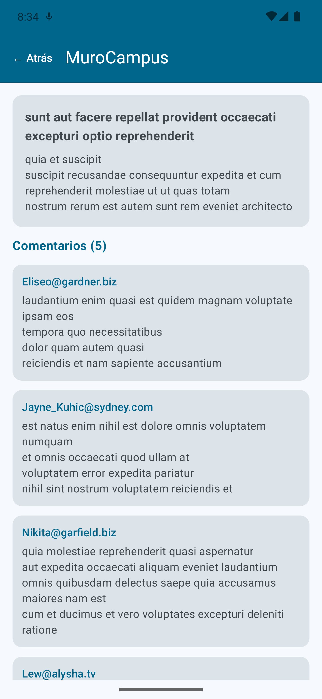
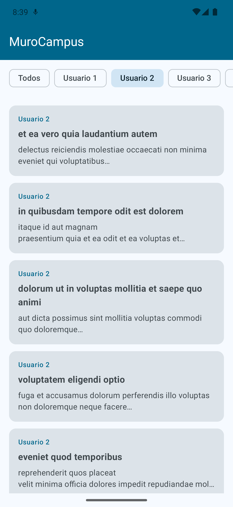
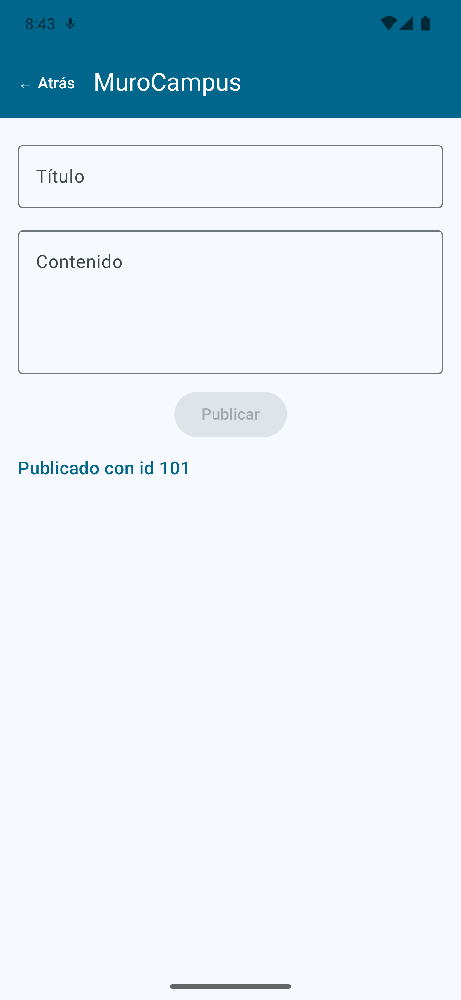
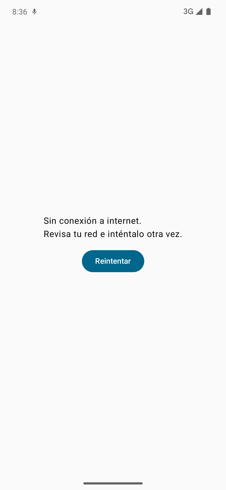

# MuroCampus Huanco

Aplicación Android desarrollada para el laboratorio de Programación en Móviles de TECSUP. Muestra publicaciones de JSONPlaceholder, permite consultar sus comentarios, filtrar publicaciones por usuario y enviar una publicación de prueba.

> JSONPlaceholder simula el `POST`: devuelve la publicación con id `101`, pero no la persiste en el servidor.

## Funcionalidades

- Carga publicaciones con Retrofit y muestra estados de carga, éxito y error.
- Permite reintentar una llamada cuando falla la conexión.
- Muestra el detalle de una publicación y sus comentarios.
- Filtra por Todos o por los usuarios del 1 al 10.
- Envía una publicación de prueba con `POST` y `@Body`.

## Tecnologías

- Kotlin y Jetpack Compose
- Arquitectura MVVM
- Retrofit y OkHttp
- Kotlin Serialization
- Coroutines, `StateFlow` y Lifecycle Compose

## Estructura del proyecto

```text
app/src/main/java/com/tecsup/murocampus/
├── MainActivity.kt
├── data/
│   ├── PostRepository.kt
│   └── remote/
│       ├── PostApi.kt
│       └── RetrofitClient.kt
├── model/
│   └── Modelos.kt
├── ui/
│   ├── Componentes.kt
│   ├── PantallaCrear.kt
│   ├── PantallaDetalle.kt
│   ├── PantallaLista.kt
│   └── theme/
└── viewmodel/
    ├── PostsViewModel.kt
    ├── PostsViewModelFactory.kt
    └── UiState.kt
```

## Arquitectura MVVM



La interfaz solo presenta el estado y comunica acciones. El ViewModel coordina las operaciones y expone estado mediante `StateFlow`. El repositorio encapsula las llamadas remotas y devuelve `Result`, para que los errores se muestren en la interfaz sin escapar como excepciones.

## Evidencias de pantalla

Las capturas están en [`evidencias/`](./evidencias/). Cada imagen se puede abrir en tamaño completo con el enlace debajo.

### Lista de publicaciones



[Abrir captura de la lista](./evidencias/lista-publicaciones.png)

### Detalle y comentarios



[Abrir captura del detalle](./evidencias/detalle-comentarios.png)

### Filtro por usuario



[Abrir captura del filtro](./evidencias/filtro-usuario-2.png)

### Crear publicación



[Abrir captura de creación](./evidencias/crear-publicacion.png)

### Error de conexión



[Abrir captura del error de conexión](./evidencias/error-sin-conexion.png)

## Verificaciones realizadas

- La app compila con `./gradlew assembleDebug`.
- La lista muestra las publicaciones del servicio y el detalle carga cinco comentarios para la publicación 1.
- El filtro Usuario 2 consulta `posts?userId=2` y devuelve diez publicaciones; Todos vuelve a consultar `posts`.
- Con campos vacíos, Publicar está deshabilitado. Al enviar, el servicio responde HTTP 201 y la app muestra `Publicado con id 101`.
- Sin conexión se muestra el mensaje de error y el botón Reintentar.

## Para pensar

1. **¿Qué diferencia hay entre GET y POST? ¿Por qué crear lleva `@Body` y porUsuario lleva `@Query`?**  
   `GET` consulta recursos; `POST` envía datos para crear o procesar un recurso. `crear` usa `@Body` porque manda el objeto `NuevoPost` en el cuerpo JSON. `porUsuario` usa `@Query` porque agrega el filtro a la URL, por ejemplo `posts?userId=2`.

2. **¿Por qué la ruta es `posts` y no `/posts`?**  
   Retrofit combina rutas relativas con la URL base, que termina en `/`. La ruta `posts` se agrega a esa base. Una ruta que comienza con `/` se resuelve desde la raíz del host y puede descartar segmentos de una URL base que tuviera una ruta propia.

3. **¿Por qué el Repository devuelve `Result` en vez de dejar que la excepción llegue al ViewModel?**  
   `Result` representa explícitamente éxito o fallo y permite que el ViewModel transforme el fallo en el estado de error de la pantalla. El repositorio también vuelve a lanzar `CancellationException` para respetar la cancelación de coroutines.

4. **¿Qué pasa si se olvida el permiso INTERNET? ¿Y si el servidor agrega un campo nuevo?**  
   Sin `INTERNET`, la app no puede realizar la conexión. `ignoreUnknownKeys = true` permite ignorar campos adicionales que el modelo no usa; sin esa opción, una clave JSON desconocida puede causar un error de serialización.

5. **¿Por qué la pantalla usa `when` sobre `UiState` y no tres variables booleanas?**  
   `UiState` expresa un único estado activo —cargando, éxito o error— y `when` permite tratar cada caso claramente. Con varios booleanos podrían quedar combinaciones contradictorias, como éxito y error activos a la vez.

6. **JSONPlaceholder no guarda los POST. ¿Cómo cambiaría la app con un servicio real?**  
   Se usaría la API real, incluyendo autenticación si corresponde. El servidor persistiría la publicación y devolvería su representación guardada; la app podría añadirla al estado de la lista o volver a cargarla desde el servidor.
